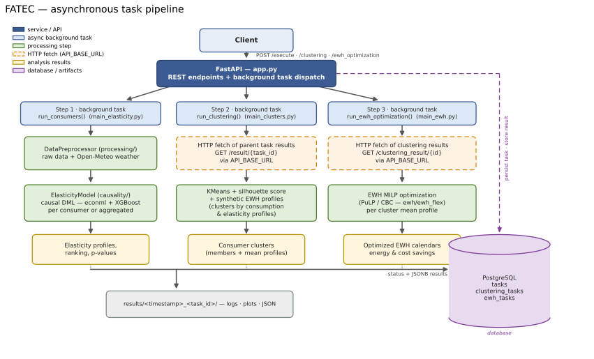

# FATEC - Flexibility Assessment tool for Energy Communities

**Description**: FATEC (Flexibility **A**ssessment tool for Ener**g**y C**ommunities**) quantifies how much — and when — the members of an energy community can flex their electricity consumption. It ingests consumption data from energy-community pilot projects, enriches it with weather information from the [Open-Meteo API](https://open-meteo.com/), and uses a causal-inference model (ECONML + XGBoost) to estimate the hourly price elasticity of demand of each consumer. On top of that, it groups consumers into behavioural clusters (KMeans with silhouette scoring) and computes cost/energy-optimal schedules for electric water heaters (EWH). Everything is executed as asynchronous tasks through a FastAPI service with results stored in PostgreSQL.

By turning raw consumption data into concrete flexibility metrics (per consumer, per cluster, per appliance), FATEC helps energy-community operators and demand-response managers identify who can respond, how much they can shift, and what that is worth in energy savings — supporting the design of fair and effective flexibility strategies.

> [!NOTE]
> This tool is a pure API — it has no standalone GUI. Interactive, runnable documentation is provided by FastAPI's Swagger UI (see [Usage](#usage)). The EWH submodule optionally ships a Streamlit GUI (see [ewh/README.md](ewh/README.md)).

## Project Status

> **🔧 Maintenance** — No new features are planned, but bugs will be fixed.

## Technology Stack

- **Language:** Python 3.8+
- **Web framework:** [FastAPI](https://fastapi.tiangolo.com/) + [Uvicorn](https://www.uvicorn.org/) (asynchronous background tasks)
- **Database:** PostgreSQL ([SQLAlchemy](https://www.sqlalchemy.org/) ORM, JSONB results)
- **Causal inference & ML:** [ECONML](https://www.pywhy.org/EconML/), [DoWhy](https://why.readthedocs.io/), XGBoost, scikit-learn, statsmodels
- **Data & weather:** pandas, numpy, requests (Open-Meteo API)
- **Optimization:** PuLP (CBC MILP solver) for EWH scheduling
- **Other tools:** python-dotenv, loguru
- **Nature:** Standalone web service (not a library/module)

## Dependencies

- All core dependencies are listed in [`requirements.txt`](requirements.txt). Install them with `pip install -r requirements.txt` (see [Installation](#installation)).
- **Additional EWH dependencies (not in `requirements.txt`):**
  - `pulp` — required for the EWH optimization (CBC solver backend). Install with `pip install pulp`.
  - `streamlit` and `plotly` — only required if you want to run the optional EWH GUI (`ewh/main_gui.py`).
- **Environment variables:** The app is configured through a `.env` file. A template is provided in [`.env.example`](.env.example):

  | Variable | Description |
  |---|---|
  | `POSTGRES_USER` | PostgreSQL user |
  | `POSTGRES_PASSWORD` | PostgreSQL password |
  | `POSTGRES_HOST` | PostgreSQL host |
  | `POSTGRES_PORT` | PostgreSQL port |
  | `POSTGRES_NAME` | Database name |
  | `API_BASE_URL` | Base URL of a **running** FATEC API instance (e.g. `http://localhost:8000`). The `/clustering` and `/ewh_optimization` pipelines retrieve previous task results through this URL, so it must point at the same service. |

- **Data:** Pilot-project data lives in `data/<partner>/` and is **not version-controlled** (see `.gitignore`). You must provide your own partner data files following the existing folder layout. Currently supported partners: `coopernico`, `ceve`, `cuerva`, `epri`, `testing`, `validation` (defined in [`settings.py`](settings.py)), for cities across Portugal, Spain, England and Ireland.

## Installation

Clone the repository:

```sh
git clone https://github.com/INESCTEC/FATEC.git
cd FATEC
```

Create and activate a virtual environment:

```sh
python -m venv venv
# On Linux/macOS:
source venv/bin/activate
# On Windows:
venv\Scripts\activate
```

Install dependencies:

```sh
pip install -r requirements.txt
# For the EWH optimization:
pip install pulp
```

Start a PostgreSQL instance and create an empty database for the tool.

Set up the environment variables:

```sh
cp .env.example .env
# Edit .env with your PostgreSQL credentials and API_BASE_URL
```

> [!TIP]
> To keep dependencies up to date, run `pip list --outdated` periodically.

## Usage

### 1. Start the API

```sh
uvicorn app:app --reload --log-level debug
```

Once running, the interactive Swagger UI is available at `http://localhost:8000/docs`.

### 2. Task flow

The tool is organized as a three-step pipeline of asynchronous tasks. Every run creates a timestamped output folder under `results/` (input JSON, logs, plots, result JSON).

| Step | Submit | Poll result |
|---|---|---|
| 1. Elasticity analysis | `POST /execute` | `GET /result/{task_id}` |
| 2. Consumer clustering | `POST /clustering` | `GET /clustering_result/{clustering_id}` |
| 3. EWH optimization | `POST /ewh_optimization` | `GET /ewh_result/{ewh_task_id}` |

Submitting a step returns a task ID and `status: "pending"`. Poll the result endpoint until `status` becomes `"completed"` (or `"failed"`, with an `error` field in `outputs`).

### 3. Step 1 — Elasticity analysis (`POST /execute`)

Estimates the 24h price-elasticity-of-demand profile for each consumer (per-consumer or aggregated).

```sh
curl -X POST http://localhost:8000/execute \
  -H "Content-Type: application/json" \
  -d '{
    "partner": "coopernico",
    "consumers": ["MAC000005", "MAC000014", "MAC000015"],
    "city": "Porto",
    "aggregated": 0
  }'
```

| Field | Type | Description |
|---|---|---|
| `partner` | string | One of `coopernico`, `ceve`, `cuerva`, `epri`, `testing`, `validation` |
| `consumers` | list of strings | Consumer IDs available in `data/<partner>/` |
| `city` | string | City where the consumers are located (see `settings.py`) |
| `aggregated` | int (0 or 1) | `0` = analyze consumers individually, `1` = aggregate them |

Response:

```json
{ "task_id": "d040212f-e9a3-4623-a42a-af5cd88f04c7", "status": "pending" }
```

Retrieve the result:

```sh
curl http://localhost:8000/result/<task_id>
```

On completion, `outputs` contains:

```json
{
  "elasticity": { "MAC000005": [ /* 24 hourly values */ ], "MAC000014": [ /* ... */ ] },
  "ranking": { "order": ["MAC000014", "MAC000005", "MAC000015"], "magnitude": [ /* ... */ ] },
  "pval": { "MAC000005": 0.02, "MAC000014": 0.01 }
}
```

(`ranking` and per-consumer detail are only present when `aggregated = 0`; `ranking` requires more than one consumer.)

### 4. Step 2 — Consumer clustering (`POST /clustering`)

Groups the consumers of a **completed** elasticity task (by consumption + elasticity profiles, plus synthetic EWH profiles). It retrieves that task's results through `API_BASE_URL`, so the API must be running and `API_BASE_URL` must point to it.

```sh
curl -X POST http://localhost:8000/clustering \
  -H "Content-Type: application/json" \
  -d '{
    "task_id": "<task_id from POST /execute>",
    "min_clusters": 2,
    "max_clusters": 8
  }'
```

| Field | Type | Description |
|---|---|---|
| `task_id` | UUID | ID of a **completed** elasticity task |
| `min_clusters` | int (≥ 2) | Minimum number of clusters to evaluate |
| `max_clusters` | int (> 2) | Maximum number of clusters to evaluate (evaluated range: `min_clusters … max_clusters-1`) |

> [!NOTE]
> The parent elasticity task must contain more consumers than `min_clusters`, or the task fails.

Response: `{ "clustering_id": "...", "status": "pending" }`. Poll with:

```sh
curl http://localhost:8000/clustering_result/<clustering_id>
```

On completion, `outputs` contains the optimal number of clusters, silhouette scores, and per-cluster members plus mean consumption/elasticity/EWH-load/EWH-usage profiles (`clusters.json` is also saved in the run folder alongside `silhouette_scores.png` and `cluster_profiles.pdf`).

### 5. Step 3 — EWH optimization (`POST /ewh_optimization`)

Computes the cost/energy-optimal operating calendar of the electric water heater for the **mean profile of each cluster** produced in step 2 (MILP via PuLP/CBC). It takes a **clustering task ID** and retrieves those results through `API_BASE_URL`.

```sh
curl -X POST http://localhost:8000/ewh_optimization \
  -H "Content-Type: application/json" \
  -d '{ "task_id": "<clustering_id from POST /clustering>" }'
```

Response: `{ "ewh_task_id": "...", "status": "pending" }`. Poll with:

```sh
curl http://localhost:8000/ewh_result/<ewh_task_id>
```

On completion, `outputs` contains, per cluster, the EWH specs, mean load profile and the optimization output (optimized load calendar, energy/cost savings, ranking; `opt_results.json` and `ewh_optimization_comparison.pdf` are saved in the run folder).

## Architecture

The service exposes REST endpoints that persist tasks in PostgreSQL and run the heavy computation asynchronously via FastAPI background tasks. The clustering and EWH steps fetch previous results over HTTP (`API_BASE_URL`), which keeps every step stateless with respect to the filesystem.



> [!TIP]
> The diagram source and a description of each component are in [`docs/diagrams/architecture.md`](docs/diagrams/architecture.md). The image is rendered with `python docs/diagrams/render_architecture.py` (matplotlib) — re-run it if you change the pipeline.

## Known issues

- **Pilot data is not version-controlled.** `data/<partner>/` files are git-ignored (see `.gitignore`), so a fresh clone has no input data — you must supply your own partner data files following the existing layout.
- **`API_BASE_URL` must reach a live instance of this API.** The `/clustering` and `/ewh_optimization` tasks fetch previous results over HTTP; if the API (or the URL) is unavailable, those tasks fail.

## Open source licensing info

This project is licensed under the MIT License — see [`LICENSE`](LICENSE). Third-party notices are listed in [`THIRD_PARTY_NOTICES_FATEC.txt`](THIRD_PARTY_NOTICES_FATEC.txt).

## Links for Docs & demos

- **Interactive API docs (Swagger UI):** `http://localhost:8000/docs` — available after starting the server (step 1 of [Usage](#usage)).
- **EWH module documentation** (methodology, mathematical formulation, inputs/outputs): [`ewh/README.md`](ewh/README.md) and the `ewh/docs/` directory.
- **ECONML** (causal inference library used for elasticity): https://www.pywhy.org/EconML/
- **Open-Meteo API** (weather data source): https://open-meteo.com/en/

## Credits and References

- **Carlos Silva** (INESC TEC) — FATEC tool: data processing, causal elasticity analysis, API service.
- **José Paulos** (INESC TEC) — EWH optimization module (`ewh/`).
- **Rafael Friães** (INESC TEC) — FATEC development and validation.

### Contacts

- [Carlos Silva](mailto:carlos.silva@inesctec.pt)
- [José Paulos](mailto:jose.paulos@inesctec.pt)
- [Rafael Friães](mailto:rafael.friaes@inesctec.pt)
